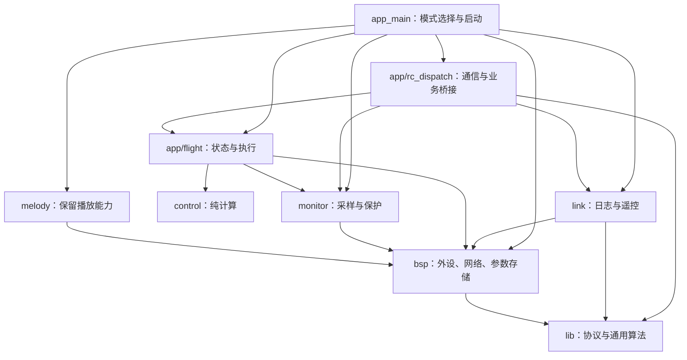
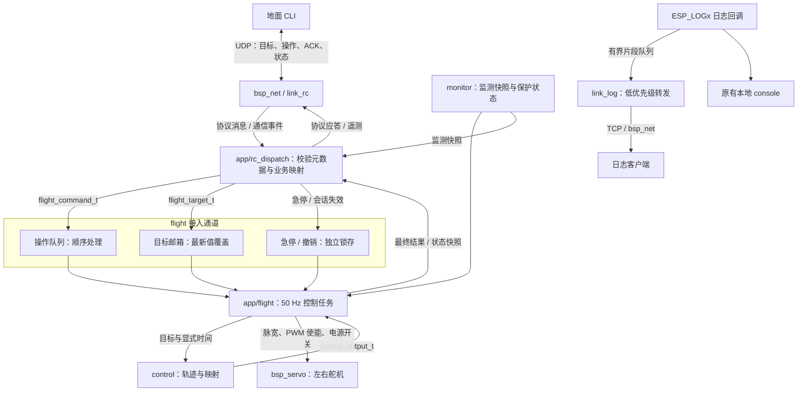
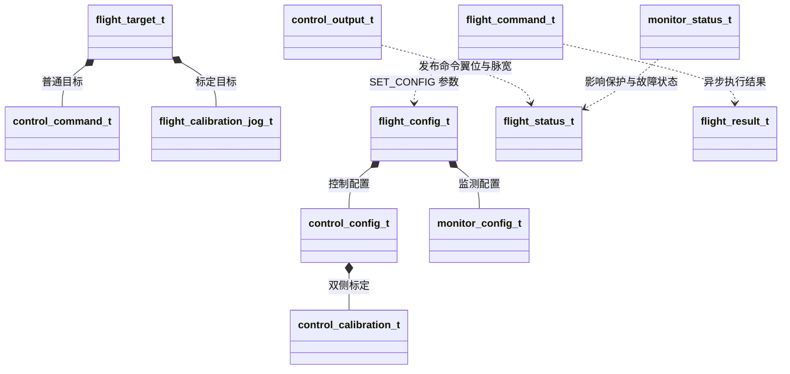
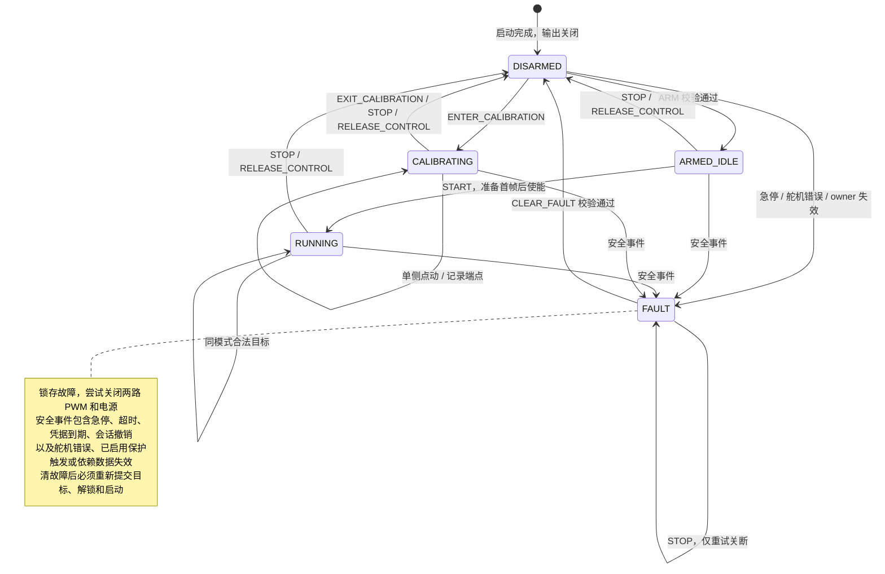
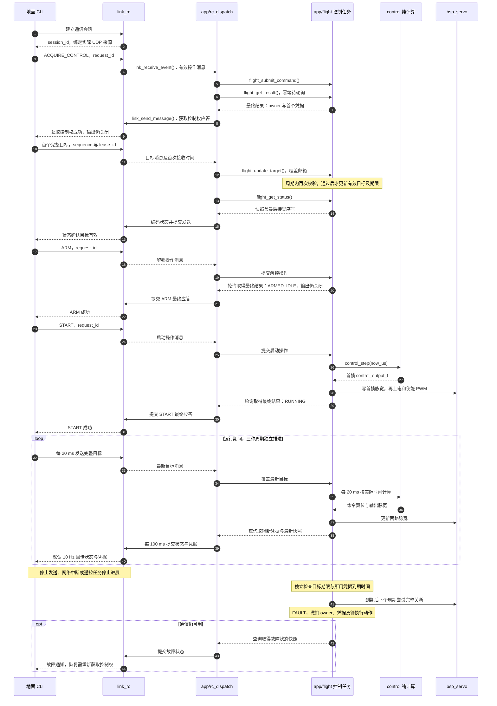
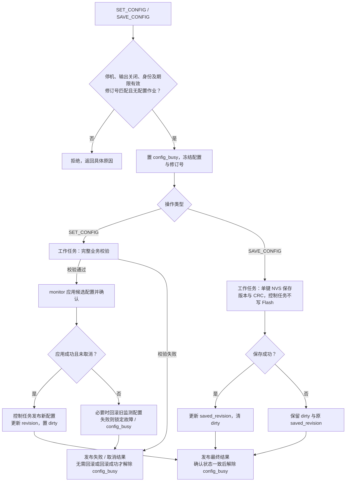

# App 与 Service 层第一阶段：完成可独立运行的开环控制

## 1. 目标、现状与范围

先交付“地面端下发命令 → 左右翼定点或正弦扑动 → 回传状态”的完整链路，以台架验证为验收目标。本文细化到模块任务、数据结构、API、线程归属及验收产物，可据此拆分实现任务。

### 1.1 当前代码基础

| 位置 | 已有能力 | 本轮处理 |
|---|---|---|
| `src/app/app_main.c` | BSP 初始化、周期采样、Wi-Fi 连接及网络测试入口 | 保留 bring-up，增加开环服务启动分支 |
| `src/bsp/servo/` | 双通道 50 Hz PWM、脉宽设置、输出及电源开关 | 复用接口，修正关电时遇错提前返回的问题 |
| `src/bsp/adc/`、`src/bsp/baro/` | ADC 原始值/引脚毫伏值、气压和温度读取 | 由 `monitor` 统一采样并转换 |
| `src/bsp/com/` | Wi-Fi、TCP/UDP、UART 原始收发 | 承接日志与遥控，不加入飞行策略 |
| `src/bsp/params/` | NVS、数值参数、带版本和 CRC 的结构化存储 | 复用 `bsp_params_save_struct()` / `bsp_params_load_struct()` |
| `src/service/melody/` | 阻塞式乐谱播放及独立组件注册 | 保留，不在控制任务内播放 |
| `src/service/estimate/` | 已有姿态算法源文件 | 不接入本轮运行链路 |
| `tools/`、`test/host/` | 已有地面工具和网络主机测试 | 新协议独立接入，保留原有回归 |

下文 `control`、`flight`、`rc_dispatch`、`link`、`monitor` 及其接口均为**拟新增设计**，不是已经存在的 API。`flight` 和 `rc_dispatch` 属于 app 层，`control`、`link`、`monitor` 属于 service 层。代码片段用于约定接口；字段表中列出的配套枚举、联合体和结构体应在对应公共头中一并定义。

### 1.2 范围约束

- 开环不依赖 IMU；传感器缺失或初始化失败不阻止未启用相关保护的开环运行。
- 包含舵机标定、状态机、TCP 日志、UDP 遥控、气压及电源监测、参数保存和 CLI。
- 串口二进制入口后续接入；首版不包含 ELRS、姿态估计、PID 闭环和定高。
- app 组织业务，service 提供能力；依赖由 `app → service → bsp/lib` 向下，app 可直接使用 BSP。服务之间允许通过公共 API 建立明确的单向依赖，禁止循环依赖及 service/BSP/lib 反向依赖 app，不恢复 driver 层。
- 通信约定以 [通信系统实施计划](communication-plan.md) 为准；本文补充其业务结构和服务 API，不另行定义冲突的线上协议。

## 2. 模块分工与数据流

### 2.1 目录与交付文件

| 模块 | 计划文件 | 负责的任务 |
|---|---|---|
| `control` | `src/service/control/control.h`、`control.c`、`CMakeLists.txt` | 目标校验、时间推进、正弦轨迹、标定校验、翼位到脉宽映射 |
| `flight`（app） | `src/app/flight/flight.h`、`flight_types.h`、`flight.c`、`flight_config.c` | 控制权、状态机、命令/目标接入、标定、唯一舵机执行入口、配置工作任务 |
| `rc_dispatch`（app） | `src/app/rc_dispatch.h`、`rc_dispatch.c` | 消费通信事件、协议与业务类型转换、向 flight 提交、收集结果与快照、生成应答和遥测 |
| `monitor` | `src/service/monitor/monitor.h`、`monitor.c`、`CMakeLists.txt` | 独立采样、物理量换算、相对高度、数据时效和保护判断 |
| `link` | `src/service/link/link.h`、`link.c`、`link_log.c`、`link_rc.c`、`CMakeLists.txt` | 日志回调、TCP 转发、UDP 会话/路由、协议消息收发、请求去重及结果缓存 |
| `protocol` | `src/lib/protocol/protocol.h`、`protocol.c`，修改 `src/lib/CMakeLists.txt` | 纯 C 编解码、CRC、消息载荷序列化；预留串口分帧 |
| 参数存储 | `src/app/flight/flight_config.c` + 现有 `src/bsp/params/` | service 定义各自配置，flight 汇总配置与存储记录，BSP 只保存字节块 |
| app / 构建 | `src/app/app_main.c`、`Kconfig.projbuild`、各组件 CMake | 模式选择、启动/回滚、依赖注册及 Wi-Fi 关闭构建 |
| 地面工具 / 文档 | `tools/open_loop/`、`docs/open-loop-protocol.md`、`docs/open-loop-guide.md` | C/Python 协议互通、CLI、日志接收、标定与台架操作说明 |
| `melody` | 沿用 `src/service/melody/` | 保留现有播放能力，开环模式取消启动曲库轮播 |

`flight_config.c` 是 app 内 `flight` 的实现。`flight` 和 `rc_dispatch` 的源文件统一加入现有 `src/app/CMakeLists.txt`，不注册独立 service 组件。`app_main.c` 只负责模式选择、启动和退出；业务逻辑留在对应 app 模块中。不新增全局参数服务，也不要求 BSP 参数表反向链接 app/service 的 getter。

下图箭头表示代码依赖方向。service 仅暴露公共能力接口，app 内部模块负责业务协调；`link` 不包含 `flight.h` 或 `monitor.h`。



### 2.2 运行时路径

下图表示运行时数据流。`control` 将计算结果交回 `flight`，由 `flight` 唯一调用舵机；配置工作任务见第 7 节。



- `flight` 不持有 socket、IP 地址或 `bsp_net_peer_t`；只识别逻辑会话、凭据和业务消息。
- `link_rc` 只发布协议消息和通信事件，不引用 `flight_*` / `monitor_*` 类型，不直接调用 app、舵机、传感器或 NVS。
- `rc_dispatch` 通过 `link` 公共接口取消息、发应答，在 app 内调用 `flight` / `monitor`；配置及标定操作由 `flight` 协调。结果返回和状态回传不形成 `flight → link` 的代码依赖。
- 每份可变状态有明确修改者：通信会话和去重表归 `link`，业务状态和舵机输出归 `flight`，采样及监测状态归 `monitor`；跨模块通过提交接口或一致快照交互，不暴露内部队列和任务句柄。
- `monitor` 不主动写舵机。保护告警由 `flight` 在控制周期内读取并执行故障停机。
- `control` 是纯计算模块，不创建任务、不读取时间、不访问 BSP；时间由调用方显式传入。

### 2.3 公共接口通用约定

| 项目 | 约定 |
|---|---|
| 返回值 | app 模块与服务 API 使用 `esp_err_t`；协议层使用独立 `protocol_result_t` |
| 时间 | 板端单调时钟，`int64_t` 微秒；期限不使用墙上时间，不信任地面端填写的时间 |
| 数值 | 翼位 `[-1, 1]`、频率 Hz、相位 rad、脉宽 µs、电压 V、电流 A、气压 Pa、高度 m |
| 浮点输入 | 所有入口拒绝 NaN、正负无穷及越界值；校验失败不改变旧状态或刷新控制期限 |
| 指针与生命周期 | 提交时复制数据；不保留调用方临时指针；状态查询复制完整快照 |
| 线程 | 公共提交/查询接口可从任务调用；首版不承诺 ISR 可调用 |
| 状态与错误 | 区分参数错误、状态不允许、资源忙、凭据失效和底层执行错误；在线路上统一映射为协议结果码 |
| 入队与完成 | `ESP_OK` 表示提交成功；只有结果队列中的最终结果表示业务执行完成 |
| 内存 | 控制周期、日志回调及报文处理使用预分配有界缓冲；创建资源限于 start / stop 阶段 |
| 快照 | 用短临界区、短锁或等价机制保证一致性；不持锁进行网络、NVS 或传感器操作 |

### 2.4 核心数据结构关系

下图表示类型之间的包含或使用关系，字段细节见各模块章节。目标的两条组合线对应联合体的不同分支，同一目标只选择一种。



## 3. `control`：轨迹和标定映射

### 3.1 模块任务

1. 定义左右翼索引及 `HOLD` / `FLAP` 两种模式，统一归一化翼位含义。
2. 实现命令、标定及运行限值校验，错误输入整条拒绝。
3. 根据实际单调时间生成定点或正弦目标，频率更新保持公共相位连续。
4. 按每侧最小/中位/最大脉宽及反向标志分段映射，最终脉宽再限幅。
5. 提供可多实例创建的计算上下文，支持无硬件预览和主机测试。

### 3.2 数据结构

```c
typedef enum {
    CONTROL_WING_LEFT = 0,
    CONTROL_WING_RIGHT,
    CONTROL_WING_COUNT,
} control_wing_t;

typedef enum {
    CONTROL_MODE_HOLD = 0,
    CONTROL_MODE_FLAP,
} control_mode_t;

typedef struct {
    uint16_t min_us;
    uint16_t neutral_us;
    uint16_t max_us;
    bool reversed;
    bool calibrated;
} control_wing_calibration_t;

typedef struct {
    control_wing_calibration_t wing[CONTROL_WING_COUNT];
} control_calibration_t;

typedef struct {
    control_mode_t mode;
    union {
        struct {
            float position[CONTROL_WING_COUNT];
        } hold;
        struct {
            float frequency_hz;
            float amplitude[CONTROL_WING_COUNT];
            float center[CONTROL_WING_COUNT];
            float phase_offset_rad;
        } flap;
    } value;
} control_command_t;

typedef struct {
    float position[CONTROL_WING_COUNT];
    uint16_t pulse_us[CONTROL_WING_COUNT];
    float phase_rad;
    bool calibration_valid;
    bool clipped;
} control_output_t;
```

配套类型：

| 类型 | 必要字段 | 约束 |
|---|---|---|
| `control_limits_t` | `pulse_min_us`、`pulse_max_us`、`max_frequency_hz` | 首版硬限来自 BSP 的 500–2500 µs；软件频率上限不超过 5 Hz |
| `control_config_t` | `calibration`、`limits` | 保存全部映射参数；硬限只能进一步收紧，不能放宽 BSP 约束 |
| `control_context_t` | 当前配置、当前命令、公共相位、上次更新时间、命令有效标志 | 调用方持有，不共享全局可变状态；仅 `flight` 控制任务修改运行实例 |

`control` 头文件使用标准整数/浮点类型和 `esp_err_t`，不包含 `bsp_servo.h`。主机测试通过适配头提供错误码。

### 3.3 API 草案

```c
esp_err_t control_validate_calibration(const control_calibration_t *calibration,
                                       const control_limits_t *limits);
esp_err_t control_validate_command(const control_command_t *command,
                                   const control_limits_t *limits);
esp_err_t control_init(control_context_t *context, const control_config_t *config);
esp_err_t control_set_command(control_context_t *context,
                              const control_command_t *command, int64_t now_us);
esp_err_t control_step(control_context_t *context, int64_t now_us,
                       control_output_t *output);
esp_err_t control_reset(control_context_t *context, int64_t now_us);
```

- `control_init()` 允许结构合法但 `calibrated=false` 的配置，用于预览；`flight` 必须另外阻止其普通输出。
- `control_set_command()` 先把旧频率的相位推进到 `now_us`，再替换命令。验证失败时上下文保持不变。
- `control_step()` 不改变硬件使能状态；返回的翼位是命令值，脉宽是计算值。
- `control_reset()` 清空运行目标、相位与时间状态，保留配置；未重新设置目标前不产生有效运行输出。
- 时间回退属于参数错误，不用负时间推进相位；控制任务长时间未调度由 `flight` 处理，不补写历史 PWM。

### 3.4 轨迹与映射规则

设公共相位为 `θ`，左右中心为 `cL/cR`，幅度为 `aL/aR`，相位差为 `Δφ`：

```text
θ(t + dt) = wrap(θ(t) + 2π × frequency_hz × dt)
left(t)   = cL + aL × sin(θ(t))
right(t)  = cR + aR × sin(θ(t) + Δφ)
```

- `HOLD` 的两侧目标均在 `[-1, 1]`；`FLAP` 频率满足 `0 < f <= max_frequency_hz`，幅度非负且 `abs(center) + amplitude <= 1`。
- 幅度为零允许作为扑动待机目标；停止由状态命令表达，不用 `frequency_hz=0` 代替停机。
- 正常修改频率保持公共相位连续；修改幅度、中位或相位差可能改变瞬时翼位，首版不承诺平滑插值。
- 同一运行阶段不允许切换 `HOLD` / `FLAP`；必须 `STOP → 设置新目标 → ARM → START`。
- 映射先计算 `x = reversed ? -position : position`。`x < 0` 用中位到最小端点，`x >= 0` 用中位到最大端点分段线性插值，最后取整到 µs。
- 标定满足 `pulse_min_us <= min_us < neutral_us < max_us <= pulse_max_us`。两侧均标定后才允许普通解锁。
- 输出夹限用于浮点误差保护；合法轨迹持续出现 `clipped=true` 必须计数并定位原因，不能以静默夹限替代输入校验。

### 3.5 完成标准

主机测试覆盖独立定点、零幅度、非对称行程、左右反向、相位差、变频连续性、长时间推进、时间回退和非法浮点；确认该模块没有 BSP、FreeRTOS 或隐式时钟调用。

## 4. `app/flight`：状态机、控制权和舵机执行

### 4.1 模块任务与内部拆分

| 子任务 | 输入 | 输出 / 行为 |
|---|---|---|
| 命令入口 | `flight_command_t` | 有界入队，预留最终结果容量，返回提交结果 |
| 目标入口 | `flight_target_t` | 有界接收并覆盖旧目标；执行前再次校验 |
| 控制权管理 | 会话获取/释放、凭据、会话撤销 | 单一控制者、凭据签发、期限、高水位及会话代次 |
| 状态机 | 操作、急停、超时、保护及 BSP 错误 | 明确的状态转换和故障锁存 |
| 50 Hz 执行器 | 最新有效目标、监测快照、当前配置 | 调用 `control`，更新两路脉宽，发布状态快照 |
| 标定执行 | 单侧点动目标、端点记录 | 单侧输出、标定草稿、退出立即断电 |
| 配置工作任务 | 停机时冻结的配置作业 | 校验、监测配置应用、NVS 保存、完成结果 |

### 4.2 数据结构

| 类型 | 必要字段 | 说明 |
|---|---|---|
| `flight_state_t` | `DISARMED`、`CALIBRATING`、`ARMED_IDLE`、`RUNNING`、`FAULT` | 使用枚举，不由多个布尔量拼接运行状态 |
| `flight_fault_t` | 急停、目标超时、凭据到期、会话撤销、舵机写入/关断失败、监测保护、保护数据失效、调度超时 | 位图，保留首个故障时间及后续故障 |
| `flight_authority_t` | `session_id:u32`、`lease_id:u32` | 本地业务身份；不包含 socket 或客户端提供的到期时间 |
| `flight_lease_t` | `lease_id:u32`、`issued_at_us:i64`、`expires_at_us:i64` | `flight` 签发并维护；凭据仅发给对应控制会话 |
| `flight_target_t` | `authority`、`sequence:u32`、`received_at_us:i64`、`kind`、目标联合体 | `kind` 为普通控制或标定点动；联合体为 `control_command_t` / `flight_calibration_jog_t` |
| `flight_command_t` | `authority`、`request_id:u32`、`received_at_us:i64`、`operation`、参数联合体 | 离散操作；`rc_dispatch` 从 link 事件复制首次本地接收时间，不能使用分发时间或线上自报时间 |
| `flight_result_t` | `session_id`、`request_id`、`operation`、`stage`、业务结果码、底层 `esp_err_t`、状态、配置修订号、可选结果载荷 | `stage` 区分执行中和最终结果；可选载荷用于控制权/配置查询 |
| `flight_calibration_jog_t` | `wing`、`pulse_us` | 持续更新的单侧原始脉宽目标；同样受凭据及超时约束 |
| `flight_calibration_record_t` | `wing`、`point`、`reversed` | `point` 为 MIN / NEUTRAL / MAX / REVERSE；前三项记录当前已成功下发脉宽，REVERSE 只更新反向标志 |
| `flight_config_t` | `control:control_config_t`、`monitor:monitor_config_t`、`calibration_max_step_us:u16` | 停机配置整体；点动步长限值需台架确认 |
| `flight_start_config_t` | `config:flight_config_t`、`servo_ready:bool`、`monitor_started:bool`、`config_load_error:esp_err_t`、`max_cycle_interval_us:i64` | app 的启动输入；初始化失败作为诊断信息保留；调度间隔上限必须大于 20 ms，具体值经台架确认 |
| `flight_status_t` | 见下表 | 不暴露 FreeRTOS 容器或驱动句柄 |

`flight_status_t` 至少包含：

| 字段组 | 字段 |
|---|---|
| 状态 | `timestamp_us`、`state`、`fault_flags`、`first_fault_at_us`、`last_error`、`shutdown_error` |
| 输出 | `mode`、`target_valid`、`command_position[2]`、`pulse_us[2]`、`output_enabled[2]`、`power_enabled`、`output_valid` |
| 标定 / 配置 | `calibrated[2]`、`config_revision`、`saved_revision`、`config_dirty`、`config_busy`、`calibration_wing` |
| 控制权 | `owner_session_id`、`session_generation`、`last_target_sequence`、`last_valid_target_us`、`control_deadline_us`、`current_lease` |
| 运行统计 | `cycle_count`、`last_cycle_interval_us`、`max_cycle_interval_us`、`last_cycle_execution_us`、`max_cycle_execution_us`、`deadline_miss_count`、命令队列高水位、目标覆盖数、目标执行拒绝数 |

`power_enabled` / `output_enabled` 表示软件已成功执行的使能状态，不代表物理供电实测；发生关断错误时 `output_valid=false`，同时保留关断错误，不能声称硬件已确认断电。`current_lease` 是内部快照字段，`rc_dispatch` 只能将其编入所属会话的应答/遥测，不能包含在匿名查询或日志中。

### 4.3 API 草案

```c
esp_err_t flight_start(const flight_start_config_t *config);
esp_err_t flight_submit_command(const flight_command_t *command);
esp_err_t flight_update_target(const flight_target_t *target);
esp_err_t flight_latch_estop(void);
esp_err_t flight_revoke_session(uint32_t session_id);
esp_err_t flight_get_status(flight_status_t *status);
esp_err_t flight_get_result(flight_result_t *result, uint32_t timeout_ms);
esp_err_t flight_get_config(flight_config_t *config, uint32_t *revision);
esp_err_t flight_stop(uint32_t timeout_ms);
```

| API | 调用与完成语义 |
|---|---|
| `flight_start()` | 创建任务/缓冲并进入 `DISARMED`；重复启动拒绝，不自动获取控制权或使能舵机 |
| `flight_submit_command()` | 不等待队列空间；队列或结果容量不足立即返回忙；操作成功与否由 `flight_get_result()` 返回 |
| `flight_update_target()` | 复制并覆盖邮箱。入口检查字段/身份/序号，控制任务执行前再次检查当前状态、代次、期限及业务约束；只有执行校验通过才刷新期限 |
| `flight_latch_estop()` | 原子锁存并通知控制任务，不经过普通队列；停机前始终保持有效 |
| `flight_revoke_session()` | 独立锁存撤销当前匹配会话并通知任务；不依赖操作队列容量 |
| `flight_get_status()` / `flight_get_config()` | 返回一致快照，不读取外设或 Flash；快照包含配置修订号 |
| `flight_get_result()` | 单消费者为 app 的 `rc_dispatch`；支持零等待轮询，队列为空返回超时 |
| `flight_stop()` | 应用模块生命周期停止：通过独立停止标志请求停机，等待输出关闭及任务退出；不依赖普通队列空间；超时返回错误，不能释放仍被任务使用的资源 |

业务 `STOP` 与 `flight_stop()` 不同：前者让控制任务继续运行、状态回到停机；后者用于应用退出/启动回滚。

### 4.4 操作命令及参数联合体

以下操作均通过 `flight_command_t.operation` 区分；没有参数的操作不解释联合体中的其他字节。

| 操作 | 参数 | 条件及效果 |
|---|---|---|
| `ACQUIRE_CONTROL` | 无 | `rc_dispatch` 已取得 link 验证来源及会话的消息；无其他控制者时绑定 owner，签发首个凭据，不解锁 |
| `RELEASE_CONTROL` | 无 | 当前 owner；先停机，清目标、凭据和排队动作，再释放控制权；已有故障不清除 |
| `ARM` | 无 | owner、有效凭据、最近有效普通目标、舵机就绪、双侧标定有效、保护就绪、无配置作业 |
| `START` | 无 | `ARMED_IDLE` 且完整目标仍有效；准备首帧脉宽后开启输出 |
| `STOP` | 无 | owner；关闭 PWM 和电源，清空运行目标及待执行运动操作；无故障则回到 `DISARMED` |
| `CLEAR_FAULT` | 无 | owner、有有效凭据、输出关闭、可恢复故障原因已消失；清故障后到 `DISARMED` |
| `ENTER_CALIBRATION` | 单侧 `wing`、显式 `initial_pulse_us` | `DISARMED`、owner、有有效标定目标与凭据；初始脉宽须与该目标一致；进入单侧标定 |
| `RECORD_CALIBRATION` | `flight_calibration_record_t` | `CALIBRATING`；在草稿记录当前实际下发的脉宽，检查端点完整性及顺序 |
| `EXIT_CALIBRATION` | `commit_draft:bool` | 先关闭两侧输出和电源；完整合法草稿可替换 RAM 配置并置 dirty，取消则保留旧配置 |
| `SET_CONFIG` | 完整 `flight_config_t`、`expected_revision:u32` | 仅 `DISARMED`；校验后应用到 RAM，不隐式写 Flash |
| `SAVE_CONFIG` | `expected_revision:u32` | 仅 `DISARMED`；冻结当前修订号并交工作任务，先执行中应答，保存后最终应答 |
| `ZERO_ALTITUDE` | 无 | 仅 `DISARMED`、气压有效；由工作任务请求 `monitor` 建立本次开机的高度基准 |

状态及配置查询直接读取快照，仍使用带请求编号的协议响应；`ESTOP` 走独立锁存路径。普通控制与标定点动均由 `flight_update_target()` 提交，不塞入操作队列。

### 4.5 状态转换

图中只列主路径；每条操作边都必须满足下方表格及第 4.4 节的身份、凭据和状态条件。



| 当前状态 | 事件 | 下一状态 | 输出行为 |
|---|---|---|---|
| 启动 | 初始化完成 | `DISARMED` | 电源关、PWM 关 |
| `DISARMED` | 合法 `ARM` | `ARMED_IDLE` | 保持电源关、PWM 关，仅确认动作许可 |
| `ARMED_IDLE` | 合法 `START` | `RUNNING` | 写首帧脉宽 → 上电 → 使能两路 PWM |
| `RUNNING` | 同模式合法目标 | `RUNNING` | 下一周期更新目标；不隐式切换模式 |
| `DISARMED` | 合法 `ENTER_CALIBRATION` | `CALIBRATING` | 写指定初始脉宽 → 上电 → 仅使能选中侧 PWM |
| `CALIBRATING` | 合法标定点动目标 | `CALIBRATING` | 仅更新选中侧，逐次变化不超过配置步长 |
| `CALIBRATING` | `EXIT_CALIBRATION` / `STOP` | `DISARMED` | 关闭两侧 PWM 及电源 |
| `ARMED_IDLE` / `RUNNING` | `STOP` / `RELEASE_CONTROL` | `DISARMED` | 关闭两侧 PWM 及电源，清目标 |
| 任意已启动状态 | 急停、舵机错误 | `FAULT` | 锁存故障，尝试完整关断 |
| 持有控制权的状态 | 超时、凭据到期、会话撤销 | `FAULT` | 停机并撤销控制权、凭据及排队动作 |
| `ARMED_IDLE` / `RUNNING` / `CALIBRATING` | 已启用保护触发、保护数据失效 | `FAULT` | 停机，不自动恢复 |
| `FAULT` | `STOP` | `FAULT` | 再次尝试关断，不隐式清故障 |
| `FAULT` | 合法 `CLEAR_FAULT` | `DISARMED` | 保持关闭，之后必须重新设置目标、解锁、启动 |

未列出的转换拒绝并应答，不改变输出。无 owner 的 `DISARMED` 不产生控制失联故障；故障后允许新会话重新获取控制权用于诊断和清故障，不能因此恢复输出。

### 4.6 控制权、凭据与目标期限

- `link` 管理通信会话及其真实 UDP 来源，`rc_dispatch` 传递经验证的会话身份，`flight` 管理动作控制权。建立会话不等于获得控制权，获得控制权不等于解锁。
- 凭据默认有效 500 ms，`flight` 每 100 ms 发布新凭据；内部保留仍在原期限内的旧凭据，不能因换发新凭据使在途合法帧立即失效。可先用 6 项固定表，按到期时间回收。
- 控制目标默认每 20 ms 提交一次。目标序号在同一会话内严格递增，接近编号耗尽时重新建立会话，不允许回绕复用。
- 期限为 `min(最后有效目标的本地接收时间 + 500 ms, 该目标凭据到期时间)`。检查使用板端保存的凭据记录，不能接受客户端自报期限。
- 获取控制权后允许在首个凭据期限内发送首个完整目标；未收到目标时不能 `ARM` / 进入标定，到期撤销控制权。
- 普通操作在执行前复核 owner、代次、状态及期限；最晚开始时间不超过首次接收后 500 ms 和所用凭据的原到期时间。重试沿用首次接收时间，不延长排队动作寿命。已开始的停机配置作业允许异步完成，但全程保持输出关闭。
- 拒绝的目标、查询、日志流量、操作重试和新凭据签发均不延长当前目标期限；新凭据只有随合法新目标被接受后才参与新的期限。
- 会话撤销、急停或超时后清空邮箱及排队运动操作，递增代次。旧会话的延迟目标、结果和配置完成通知不能作用到新控制会话。
- 格式合法的急停允许绕过控制权竞争；清故障、标定和启动不得绕过 owner 校验。
- 凭据用于限制迟到控制帧的有效时间；首阶段不因此宣称提供加密或身份认证能力。

普通目标可在 `DISARMED` / `ARMED_IDLE` 下预提交，标定目标可在 `DISARMED` 下预提交；预提交只建立有效目标和在线证明，不使能输出。进入标定时明确使用该单侧初始脉宽，后续点动才以它为基准检查步长。清故障或配置切换后清目标，要求重新提交。

以下时序展示首次运行及失联停机；图中的目标发送与凭据换发在操作请求期间也持续进行。



### 4.7 50 Hz 控制周期与停机

控制任务以 20 ms 周期运行，按实际单调时间推进轨迹，每轮执行：

1. 读取急停/会话撤销锁存，检查控制期限、监测数据时效及调度异常；安全事件优先停机。
2. 有界处理操作和配置完成事件；首版每周期最多处理 1 条普通操作，禁止无限排空队列。
3. 读取最新目标并完成执行校验；`START` 等依赖目标的操作须看到最新已验证目标，可留待下一周期执行。
4. 状态允许时执行 `control_step()` 或单侧标定点动，写入脉宽；写任意一侧失败即走完整关断。
5. 再次检查本轮新产生的安全事件，发布状态和结果，等待下个周期；不补执行错过的历史帧。

同一轮已进入故障后，不能被排队的 `ARM` / `START` 覆盖。停机需要清理旧运动操作，避免 `STOP` 后排队启动再次执行。

统一内部关断函数要尝试两侧 PWM 关闭和电源关断，收集首个错误并保留完整失败位图。必须同步修正现有 `bsp_servo_power_enable(false)`：某侧 `force_idle` 失败也继续处理另一侧及电源 GPIO，并检查 GPIO 写入结果；保留原公共 API。

50 Hz 为软件调度和 PWM 更新频率，不代表脉宽写入与 PWM 周期边界完全同步。首版状态切换只保证固件执行顺序；启停波形、两侧更新时差和机械冲击必须通过示波器及台架验收。

### 4.8 完成标准

用时钟、舵机、监测及存储替身覆盖状态转换、满队列急停、撤销竞争、超时、旧代次消息、单侧写失败、关断部分失败和应用模块退出；确认开环模式除 BSP 初始化外，只有 `app/flight` 写舵机，`app_main`、`rc_dispatch` 和各服务均不直接执行输出。

## 5. `monitor`：采样、换算与保护

### 5.1 模块任务

1. 单独低优先级任务初始化并读取 ADC / 气压计；每个通道记录最后成功时间和错误。
2. 保留原始码值与引脚毫伏值，仅在换算系数标定有效时发布电池电压/舵机电流。
3. 提供气压、温度、相对气压高度；高度基准仅通过停机归零建立。
4. 独立维护有效位、告警、保护触发和新鲜度，不用一个“传感器正常”布尔值概括所有通道。
5. 向 `flight` 提供快照，不直接发网络包或操作舵机。

### 5.2 数据结构

| 类型 | 必要字段 | 说明 |
|---|---|---|
| `monitor_config_t` | `sample_period_ms`、`stale_timeout_ms`、`vbat_scale`、`vbat_offset_v`、`current_gain_a_per_v`、`current_zero_v`、两项换算标定标志、`undervoltage_v`、`overcurrent_a`、两项保护使能、`trip_delay_ms`、`recover_hysteresis` | 默认采样周期 100 ms，失效阈值 500 ms；滞回分别使用 V / A 字段 |
| `monitor_valid_t` | ADC 原始值、引脚电压、电池电压、舵机电流、气压、温度、相对高度各自的有效位 | 未标定/未归零不置对应物理量有效位 |
| `monitor_alarm_t` | 欠压、过流、依赖数据失效 | 告警位图及首次触发时间 |
| `monitor_status_t` | `timestamp_us`、`last_adc_success_us[2]`、`last_baro_success_us`、`adc_raw[2]`、`adc_mv[2]`、`battery_v`、`servo_current_a`、`pressure_pa`、`temperature_c`、`relative_altitude_m`、`reference_pressure_pa`、`reference_valid`、`valid_flags`、`alarm_flags`、`protection_ready`、`config_revision`、各通道 `last_error` / 失败计数 | 上次样本及其时效须同时发布，避免旧值被当成新值 |

物理量转换约定：

```text
battery_v       = adc_vbat_mv / 1000 × vbat_scale + vbat_offset_v
servo_current_a = (adc_current_mv / 1000 - current_zero_v) × current_gain_a_per_v
relative_height = 44330 × (1 - (pressure_pa / reference_pressure_pa)^0.1903)
```

相对高度采用标准大气近似，仅用于本轮台架显示，不作为高度闭环输入。基准必须为有限正气压；重新上电后基准无效，不直接恢复旧环境的基准值。

### 5.3 API 草案

```c
esp_err_t monitor_start(const monitor_config_t *config, uint32_t revision);
esp_err_t monitor_validate_config(const monitor_config_t *config);
esp_err_t monitor_apply_config(const monitor_config_t *config, uint32_t revision,
                               uint32_t timeout_ms);
esp_err_t monitor_zero_altitude(uint32_t timeout_ms);
esp_err_t monitor_get_status(monitor_status_t *status);
esp_err_t monitor_stop(uint32_t timeout_ms);
```

- `monitor_start()` 返回服务资源是否创建成功；单个传感器初始化失败记录在状态中，任务可降级运行。
- `monitor_apply_config()` / `monitor_zero_altitude()` 由 `flight` 配置工作任务调用，可等待采样任务确认；不能在 50 Hz 任务中阻塞调用。
- 归零使用最近的新鲜有效气压；没有有效样本时明确失败，不以零气压或默认海平面气压冒充成功。
- `bsp_baro_read()` 返回 `ESP_ERR_NOT_FINISHED` 表示没有新样本，不立即认定硬件故障，也不刷新最后成功时间。
- `monitor_get_status()` 仅复制快照；`flight` 使用当前时间再次判断样本年龄，即使采样任务卡住也能发现过期。

### 5.4 保护策略与完成标准

- 未标定电源量只显示原始值和引脚电压，不能默认使用电阻标称值进入保护。
- 启用欠压/过流保护必须同时具有有效标定、合法阈值和新鲜样本；配置不完整则拒绝启用，数据尚未就绪则拒绝解锁。
- 连续越限达到 `trip_delay_ms` 才触发阈值保护，按时间累计；数据失效则独立触发保护依赖失效，不用旧样本继续累计或恢复。
- 保护触发由 `flight` 锁存故障；恢复到滞回区间仅满足清故障条件，不自动恢复运行。
- 未启用相应保护时，ADC 或气压计异常只影响监测有效位，不阻止开环。
- 验证换算零点/增益、未标定状态、归零、无新样本、过期、阈值抖动、采样任务停滞及保护触发后的手动恢复。

## 6. `link`、`protocol` 与 `app/rc_dispatch`：日志、遥控和业务适配

### 6.1 模块任务

| 子模块 | 任务 | 不承担的工作 |
|---|---|---|
| `protocol` | 帧边界/长度/CRC 校验、逐字段序列化、消息载荷校验、共享测试向量 | 不维护 owner，不依赖 BSP / FreeRTOS |
| `link_log` | 包装日志回调、原 console 输出、有界片段缓存、TCP 客户端选择与转发 | 不接收文本控制命令，不刷新控制期限 |
| `link_rc` | UDP 有界轮询、通信会话及来源绑定、请求去重、发布协议消息/通信事件、缓存并发送协议应答和状态 | 不引用 app 类型，不调用 flight/monitor，不决定业务许可 |
| `app/rc_dispatch` | 消费 link 事件、协议与 flight 类型转换、提交命令/目标、轮询结果、汇总快照、生成应答与定期遥测 | 不持有 socket，不直接操作舵机或采样，不把入队成功作为执行成功 |
| `link` 生命周期 | 启停 BSP 网络、资源回滚、状态汇总、Wi-Fi 失效通知 | 不在控制任务中等待联网或发送 |

### 6.2 数据结构

| 类型 | 必要字段 | 可见性 |
|---|---|---|
| `link_config_t` | `tcp_log_port`、`udp_rc_port`、`max_rx_per_round` | 公共；端口默认 3333/3334，不包含业务遥测调度 |
| `link_status_t` | running、Wi-Fi 状态、日志客户端连接状态、会话数、合法包数、长度/CRC/版本错误数、重复/乱序拒绝数、去重命中数、发送拥塞数、日志丢弃/截断数、最后合法报文接收时间 | 公共快照；不宣称目标已被 flight 接受 |
| `link_event_t` | 事件种类、会话编号及通信会话代次、帧序号、请求编号、首次板端接收时间、`protocol_message_t` 消息载荷或失效原因 | 公共；不包含 app 类型或网络地址；事件为消息、急停、会话撤销/网络失效 |
| `link_tx_message_t` | 会话编号及通信会话代次、请求编号、`protocol_message_t` | 公共；app 提交的协议应答/遥测，link 校验当前路由，拒绝旧代次 |
| `rc_dispatch_config_t` | `telemetry_period_ms`、`max_events_per_round` | app 内部；默认遥测周期 100 ms，每轮普通事件预算建议 8 条 |
| `link_log_chunk_t` | `length:u16`、`data[256]` | 内部；文本片段而非完整行 |
| `link_session_t` | `session_id`、实际 UDP 来源、会话代次、建立时间、目标序号高水位、请求编号高水位、去重表 | 内部；`bsp_net_peer_t` 限于此处及日志实现 |
| `link_request_record_t` | 会话、请求编号、消息类型、规范化请求内容、首次接收时间、执行阶段、最终结果、关联配置修订号 | 内部；首版保存完整有界请求内容用于比较，不能只靠 CRC 判定内容相同 |
| `protocol_frame_t` | 版本、消息类型、会话编号、序号、请求编号、载荷长度、`payload[256]` | 协议公共类型；识别标志和 CRC 由编解码处理 |
| `protocol_message_t` | 消息种类及对应业务载荷联合体 | 纯协议类型；由 app 的 `rc_dispatch` 映射为 flight 类型，lib/link 不包含 app 或 monitor 头文件 |
| `protocol_result_t` | `OK`、`INVALID_ARGUMENT`、`INVALID_LENGTH`、`INVALID_CRC`、`UNSUPPORTED_VERSION`、`UNKNOWN_TYPE`、`NO_SPACE` | 编解码结果，不直接承载 ESP-IDF 错误 |

操作应答另含 `request_id`、阶段（`ACCEPTED` / 最终结果）、业务码和可选结果。业务码至少区分 `OK`、参数错误、状态不允许、控制权冲突、资源忙、会话/凭据失效、请求过旧、请求内容冲突及内部执行错误。

### 6.3 API 草案

```c
esp_err_t link_start(const link_config_t *config);
esp_err_t link_get_status(link_status_t *status);
esp_err_t link_receive_event(link_event_t *event, uint32_t timeout_ms);
esp_err_t link_send_message(const link_tx_message_t *message);
esp_err_t link_stop(uint32_t timeout_ms);

protocol_result_t protocol_encode(const protocol_frame_t *frame,
                                  uint8_t *buffer, size_t capacity, size_t *written);
protocol_result_t protocol_decode(const uint8_t *buffer, size_t length,
                                  protocol_frame_t *frame);
protocol_result_t protocol_encode_message(const protocol_message_t *message,
                                          protocol_frame_t *frame);
protocol_result_t protocol_decode_message(const protocol_frame_t *frame,
                                          protocol_message_t *message);
```

`link_log_start/stop`、`link_rc_start/stop` 仅作组件内部接口，放在私有头中。UART 的流解析器后续增加，不作为首轮 TCP/UDP 验收依赖。

`link_receive_event()` 的单消费者为 `rc_dispatch`，返回数据副本并支持零等待轮询；`link_send_message()` 复制消息、不等待网络发送，资源不足返回忙，`ESP_OK` 不代表对端收到。会话编号及通信会话代次由 link 验证和填写，`rc_dispatch` 为待完成请求保留这组路由关联；不能用 flight 的业务代次替代通信代次，也不能将旧请求结果发给新会话。

接入缓冲按语义区分：普通操作使用有界队列，连续目标保留各有效会话的最新值，急停和会话撤销使用独立锁存/保留槽。`link_receive_event()` 优先返回安全事件；`rc_dispatch` 在普通事件预算之前转交 `flight_latch_estop()` / `flight_revoke_session()`。普通事件队列或目标通道拥塞不能丢失安全事件；若接入或业务分发任务停止进展，flight 仍按自身期限停机。

`rc_dispatch` 有独立任务和 start/stop 生命周期，由 app 启停，优先级低于控制、高于日志。每轮先处理安全事件和已有执行结果，再有界提交普通操作/最新目标，按周期读取 flight/monitor/link 快照并生成协议遥测；所有 flight 查询和 link 提交均使用非阻塞方式，不在该任务等待配置完成。普通操作跨接入、flight、结果缓存各阶段都需预留完成结果容量；向 link 提交最终结果遇忙时保留待发结果，不能取走后丢弃。

### 6.4 UDP 消息到应用的映射

下表除建立通信会话外，业务接口均由 `app/rc_dispatch` 调用；`link_rc` 只提供经通信校验的事件和发送接口。

| 消息族 | 目标接口 | 应答规则 |
|---|---|---|
| 建立会话 | `link_rc` 创建来源绑定记录 | 返回新会话，不隐式获得控制权 |
| 获取/释放控制权、解锁、启动、停止、清故障 | `flight_submit_command()` | 非零请求编号，返回实际业务结果 |
| 定点 / 扑翼完整目标 | `flight_update_target()` | 不逐包 ACK，通过状态中的最后执行接受序号确认 |
| 标定进入/记录/退出 | `flight_submit_command()` | 操作应答；单侧点动目标使用目标接口 |
| 急停 | `flight_latch_estop()` | 锁存后可回执行中应答；最终停机状态由结果/状态确认 |
| 查询运行状态 | `flight_get_status()`、`monitor_get_status()`、`link_get_status()` | 返回采样时间和各自有效性；不携带其他会话的凭据 |
| 查询配置 | `flight_get_config()` | 按模块/分片返回配置及同一修订号，不超过 256 字节载荷 |
| 修改 / 保存配置 | `flight_submit_command()` | 状态和修订号校验；保存可先 `ACCEPTED` 再最终结果 |
| 相对高度归零 | `flight_submit_command()` | 工作任务完成后返回最终结果 |

线上帧采用小端逐字段序列化、CRC-32/ISO-HDLC，一 UDP 包一帧，载荷上限 256 字节。不得 `memcpy` C 结构体作为线上布局。精确消息编号、字段宽度、单位、量化方式、分片布局和固定报文先写入 `docs/open-loop-protocol.md`，再编写 C/Python 编解码。

首版配置写入按模块传完整配置，`rc_dispatch` 与同修订号快照合并成完整 `flight_config_t` 再提交；单个模块载荷必须满足 256 字节上限。配置查询使用同一修订号的一致快照分页，不能拼出半新半旧配置。flight 只定义业务状态和结果，协议消息号、线上的字段转换及业务错误码映射集中在 `rc_dispatch`。

### 6.5 TCP 日志与请求可靠性

- 回调使用独立 `va_copy` 保留原 console 输出及远程格式化；远程分支不分配、不访问网络、不等待队列空间。
- 日志队列首版 16 × 256 字节。超长截断计数，队列满丢新片段；无客户端时丢远程副本，不回放旧日志。
- 日志任务只服务一个客户端，其余连接输入有界丢弃；断线后排空旧会话尾部以释放 BSP 槽位。
- `bsp_net_send(..., timeout_ms=0)` 入队成功不等于对端已收到；遥测可丢，最终操作结果必须在去重缓存中保留供重试查询。
- 请求重试沿用原 `request_id`；同编号不同内容拒绝。执行中的重复请求只返回当前阶段，不能重复入队。
- 去重记录淘汰后，使用请求编号高水位拒绝旧操作再次执行；编号耗尽前重建会话。
- 接受普通操作前预留结果位置，满时拒绝新操作。急停/会话撤销独立于普通队列，不能被拥塞阻塞。
- ACK 优先于普通遥测；link 每轮 UDP 处理数、发送数及 TCP 工作量有界，`rc_dispatch` 每轮业务分发数同样有界。
- “最后有效控制接收时间”和最后执行接受序号以 `flight` 快照为准，由 `rc_dispatch` 编入遥测；link 的合法报文接收时间只表示通信活动，解码成功或邮箱入队成功不能提前算作控制目标已生效。
- start 时先建队列及任务再安装日志回调；stop 时先恢复原回调，等待在途访问结束，再回收队列及任务。

### 6.6 完成标准

C/Python 固定报文字节一致；覆盖非法长度、CRC、版本、消息类型、浮点输入、来源变化、去重、过期重试、队列满和混合负载。用替身验证 `rc_dispatch` 的类型/错误码转换、首次接收时间保留、旧通信代次结果拒绝、安全事件优先及结果背压；确认 lib/link 不包含 app 头文件，link 不调用 flight/monitor。TCP 断开或慢读时 UDP 控制继续正确执行，日志回调并发、启停反复无递归及资源泄漏。

## 7. 参数持久化：配置归属、修订与异步保存

### 7.1 数据与现有 BSP API

各服务定义自己的运行配置；app 内的 `flight` 汇总开环配置，管理应用/保存事务。BSP 不包含 app/service 头文件，不负责理解标定是否允许启动。

| 数据 | RAM 归属 | 持久化策略 |
|---|---|---|
| `control_config_t` | `flight` 的配置快照和控制上下文 | 与开环配置整体保存 |
| `monitor_config_t` | `monitor` 生效副本，`flight` 保留一致配置快照 | 与控制配置整体保存 |
| 标定草稿 | `flight` 标定上下文 | 退出并提交后替换 RAM；显式保存才落盘 |
| `flight_config_record_t` | 配置工作任务的冻结副本 | 一个 `openloop_cfg` 键，首版版本号 1 |
| 相对气压高度基准 | `monitor` | 只在本次开机有效，不持久化 |
| owner、凭据、目标、运行状态、故障、急停 | 各模块运行态 | 不持久化；重启保持停机 |

`flight_config_record_t` 使用固定宽度字段、显式标志位与保留字节，不直接保存含指针、枚举 ABI 或未初始化 padding 的运行结构。记录需包含控制限值、双侧标定、电源换算和保护配置，转换函数负责记录与运行配置的双向映射。

复用已有接口：

```c
esp_err_t bsp_params_init(void);
esp_err_t bsp_params_save_struct(const char *key, const void *data,
                                 size_t len, uint16_t version);
esp_err_t bsp_params_load_struct(const char *key, void *data, size_t len,
                                 uint16_t expected_version, uint16_t *out_version);
```

`src/app/flight/flight_config.c` 对 `app_main` 提供启动加载入口，其余保存过程为 `flight` 内部工作任务使用：

```c
esp_err_t flight_config_load(flight_config_t *config);
```

加载函数无论成功与否都给出结构合法的配置：读取或业务校验失败时填入安全默认值并返回实际错误，双侧 `calibrated=false`、保护关闭；app 将错误传入启动诊断。CRC 正确仍必须重新检查端点、有限数值、阈值和保护依赖，不能只凭存储头判定可运行。

### 7.2 应用与保存流程

配置应用与保存分成两项显式操作。图中失败均保留输出关闭；会话撤销和急停取消规则见步骤后的说明。



1. `SET_CONFIG` 带 `expected_revision`，仅在 `DISARMED`、输出关闭、无其他配置作业时接收；冲突明确拒绝。
2. 控制任务置 `config_busy`，冻结候选配置；期间拒绝 `ARM`、标定、第二个修改/保存作业，仍受理急停和会话撤销。
3. 工作任务校验全部配置，请求 `monitor` 应用并等待确认；成功后交控制任务替换控制配置、更新修订号与 dirty 标志，再返回最终结果。
4. 若部分应用失败，保持输出关闭，回滚旧监测配置；回滚失败时保持故障/配置忙锁定并报告，不能声称应用成功。
5. `SAVE_CONFIG` 冻结当前修订号和记录，工作任务调用单键结构化保存；成功才更新 `saved_revision` 并清 dirty，失败保留 dirty 和原保存修订号。
6. 作业完成事件携带作业编号及会话代次；已撤销会话的完成结果不路由到新会话。已发生的 Flash 提交不可撤回，后续查询应显示实际保存修订。

会话撤销或急停发生时，未开始的修改作业直接取消；已开始应用的作业在发布生效修订前检查取消标志，必要时先回滚监测副本再解除 `config_busy`。不能仅丢弃旧完成通知却留下已改变的监测配置。保存作业则记录其实际提交结果，不能把已落盘数据当作未发生。

所有 NVS 操作都在工作任务或启动阶段进行。保存期间保持停机；普通配置写入仅修改 RAM，不调用会立即 commit 的 `bsp_params_set_scalar()`。

选择单键完整记录避免两侧标定或保护配置跨键出现半新半旧组合；版本变化需提供显式迁移，首版不识别的版本按无有效标定处理。

### 7.3 完成标准

验证缺失键、旧版本、CRC/长度错误、业务字段损坏、配置修订冲突、运行时修改/保存拒绝、保存失败及重启恢复；确认保存时未进入控制循环，也不会自动恢复旧目标、凭据或运动状态。

## 8. app、BSP 与构建接入

### 8.1 启动与退出顺序

开环模式启动：

1. 最先 `bsp_servo_init()`，保证默认电源关闭及输出低电平；记录初始化结果，不因其他模块失败跳过安全处理。
2. 初始化 NVS，调用 `flight_config_load()`；失败保留未标定安全默认值，允许只读诊断和重新标定。
3. 启动 `monitor`；传感器初始化由监测任务持有，app 不再并发采样相同传感器。
4. 启动 `flight`，传入配置、舵机就绪和监测服务状态；保持 `DISARMED`。舵机未就绪时仅允许诊断，拒绝解锁与标定输出。
5. Wi-Fi 管理在独立低优先级流程执行，连接成功后启动 `link`，再启动 app 的 `rc_dispatch` 任务；桥接启动失败时停止 link 并保留 flight 停机诊断。连接失败保留本地诊断，不等待网络来执行安全控制。
6. 开环分支不启动 echo 测试、不轮播曲库，不要求 IMU 初始化成功。

退出时 app 先禁止 `rc_dispatch` 提交新的运动操作，让 `flight` 处理会话撤销并确认停机；再停止并等待 `rc_dispatch` 退出，停止 `link`，最后 `flight_stop()` / `monitor_stop()`。失败时只回收已确认不再使用的资源；初始化失败按已完成的启动步骤回滚，不能留下仍运行的桥接任务、日志回调或带电舵机。

Wi-Fi 断线时 `link` 清理日志客户端及通信会话，锁存会话撤销/网络失效事件；`rc_dispatch` 优先消费并调用 `flight_revoke_session()`，link 不直接调用 app。网络恢复重新建会话，不恢复控制权或动作。即使事件未及时分发，`flight` 自身的目标/凭据期限仍必须生效。

### 8.2 构建选项与组件依赖

| 项目 | 计划 |
|---|---|
| app 模式 | Kconfig choice：`BF_APP_MODE_BRINGUP` / `BF_APP_MODE_OPEN_LOOP`，默认 bring-up |
| echo 互斥 | `BF_NET_TEST_ENABLED` 仅在 bring-up 且 Wi-Fi 开启时可选，避免抢占 3333/3334 |
| Wi-Fi 关闭 | 开环 app 与服务仍可构建；不启动网络 link 及 rc_dispatch，无远程控制权时保持停机；首版不以本地直写绕过安全接口 |
| `control` | 独立组件，公开依赖 `esp_common`，数学库按工具链要求链接，不依赖 BSP / FreeRTOS |
| `monitor` | 独立组件，公开依赖 `esp_common`，私有依赖 BSP、FreeRTOS、计时组件 |
| `flight` / `rc_dispatch` | app 内部模块；源文件由 `src/app/CMakeLists.txt` 显式注册，头文件只在 app 内可见，不新增独立 flight service 组件 |
| `link` | 公开依赖 `esp_common`、提供协议公共类型的 `lib`，私有依赖 `bsp`、日志/FreeRTOS/计时组件；不依赖 app、flight 或 monitor |
| `protocol` | 纳入现有 `lib` 组件，纯 C；主机测试单独编译该目录 |
| app | 显式依赖 `control`、`monitor`、`link`、`melody`、BSP、lib、FreeRTOS 和计时组件；按模式注册业务源文件；service 子目录仍各自 `idf_component_register()` |
| 顶层 CMake / 说明 | 清理恢复 driver 层的旧描述，确认新增服务目录能被组件发现 |

`melody_play(const melody_note_t *notes, size_t count)` 沿用现有阻塞接口。本轮不增加蜂鸣器任务；若后续加入短提示音，应单独调度，不能从 `flight` 的 50 Hz 周期调用。

### 8.3 BSP 配套任务

- 舵机：修正完整关断与错误汇总，确认初始化/失败回滚时电源状态；保留 50 Hz、1 µs 分辨率和硬限。
- ADC / 气压计：复用现有接口，不在 BSP 写死分压比、电流增益、保护阈值或高度基准。
- 网络：复用多 endpoint 启动和零等待发送；超长 UDP 包使用已有长度查询/接收能力有界取走并丢弃，不能因缓冲不足一直堵在队首。
- 参数：复用带版本和 CRC 的结构化接口；如需修正通用存储问题，保持 BSP 不认识 `flight_config_t`。

## 9. 调度、缓冲与背压预算

以下为首版建议初值，不是已经测得的容量结论；实际任务栈、优先级和 WCET 通过台架记录调整。

| 资源 | 初值 / 关系 | 满载或异常行为 |
|---|---|---|
| 控制任务 | app/flight，50 Hz，在应用及服务任务中最高优先级 | 每轮有界工作；记录间隔及最大执行时间，长间隔进入调度故障 |
| 普通操作队列 | 深度 8 | 不等待，返回忙；不承载急停/撤销 |
| 最新目标邮箱 | 深度 1，覆盖语义 | 丢旧目标并计数；非法输入不能刷新期限 |
| 最终结果容量 | 至少覆盖全部已接受未取走操作；初值 16 | 入队前预留结果槽，不静默丢已接受操作的最终结果 |
| 配置工作任务 | 并发作业数 1，优先级低于控制 | 忙时拒绝新作业；不允许运行时写 Flash |
| 监测任务 | 默认 10 Hz，低于控制 | 逐通道有效性与失败计数；`flight` 独立检测快照过期 |
| link_rc 接入任务 | 高于日志，低于控制；有界收包、会话维护及发送 | ACK 优先，遥测丢弃并计数；轮询预算建议先取 8 包 |
| app/rc_dispatch 桥接任务 | 高于日志，低于控制；每轮先安全事件/结果，再有界分发与周期遥测 | 普通事件预算建议 8 条；结果忙时保留重试，不等待网络或配置作业 |
| link 接入缓冲 | 普通操作有界队列，连续目标按有效会话保留最新值，安全事件独立保留 | 普通队列满时拒绝新操作，不延长首次接收时间；安全事件优先交给桥接任务 |
| 日志任务 / 队列 | 最低服务优先级，16 × 256 字节 | 不阻塞生产者；丢弃/截断并计数 |
| 去重表 | 单会话初值 16 条，内存预算含请求内容和最终结果 | 不淘汰执行中记录；满且无可淘汰项时拒绝新请求 |
| 有效凭据表 | 初值 6 项，100 ms 换发、500 ms 有效 | 到期回收；不能覆盖仍可能被合法目标引用的有效记录 |

Wi-Fi、TCP/UDP BSP、FreeRTOS 调度和本地日志仍共享系统资源，必须实测混合负载。控制循环不执行网络连接、传感器读取、NVS、遥测发送、曲库播放或无界日志格式化；周期内只保留必要的有界诊断。

控制最大允许间隔、标定步长、保护阈值及机械可用扑动频率属于台架确认项，实施时写成有范围检查的命名配置，不能散落为魔法数。

## 10. 地面工具与协议文档

### 10.1 文件与任务

| 文件 | 任务 / 主要 API |
|---|---|
| `tools/open_loop/protocol.py` | 帧及消息数据类；`encode_frame()`、`decode_frame()`，与 C 共用固定向量 |
| `tools/open_loop/client.py` | UDP 会话/凭据、请求去重重试、连续发送、状态接收；`connect()`、`acquire_control()`、`request()`、`set_target()`、`stop_sending()`、`close()` |
| `tools/open_loop/log_client.py` | 独立 TCP 文本增量接收；日志故障不阻塞 UDP 发送 |
| `tools/open_loop/cli.py` | 人工交互、参数校验和状态展示；业务复用客户端，不自行拼帧 |
| `docs/open-loop-protocol.md` | 帧布局、消息号、字段单位、结果码、请求/凭据时序及测试向量 |
| `docs/open-loop-guide.md` | 接线、构建选项、标定、显式保存、定点/扑翼、停机和故障恢复 |

### 10.2 CLI 操作集

- 会话与诊断：`connect`、`acquire`、`release`、`status`、`logs`、`disconnect`。
- 运动：`hold L R`、`flap F AL AR CL CR PHASE`、`arm`、`start`、`stop`、`estop`、`clear`。
- 标定：`cal enter SIDE INITIAL_US`、`cal jog US`、`cal record min|neutral|max`、`cal reverse on|off`、`cal exit --commit|--discard`。
- 参数与监测：`config get`、`config set`、`config save`、`altitude zero`。

命令语法在 CLI 实现时固定；定点/扑翼命令只更新目标，不隐式解锁或启动。先发送合法完整目标并确认，再显式 `arm → start`。连续发送与用户输入独立调度，但必须支持明确的 `stop_sending()` 状态。

输入源失效、状态回传长期中断、凭据过期或用户退出时停止后台发送旧目标；尝试发送 `STOP` 后退出，停机最终仍依赖板端期限保障。每个操作显示最终应答，不能把 UDP 发出或 `ACCEPTED` 显示为执行成功。旧地面站协议兼容不作为本轮要求。

## 11. 实施任务与阶段交付

| 阶段 | 具体任务 | 依赖 | 可验收产物 |
|---|---|---|---|
| P1：类型与纯计算 | 建 `control` 组件；固定类型/单位；实现校验、映射、正弦及时钟注入 | 现有 BSP 硬限 | 公共头、纯计算实现、主机用例；无硬件可运行 |
| P2：状态与执行 | 建 `app/flight`；队列/邮箱/快照、状态机、统一关断、标定草稿；修正 BSP 停机并加入 app 构建 | P1 | BSP 替身验证完整操作与故障；断开舵机验证 PWM |
| P3：协议与日志 | 固定协议文档和向量；C/Python 编解码；TCP 回调与转发 | P1 类型约定；可与 P2 分开推进 | 固定报文互通；慢客户端与日志并发测试 |
| P4：UDP 遥控闭合 | link 事件/发送接口、会话/来源及去重；app/rc_dispatch 映射、结果与遥测；owner/凭据、期限及最小 CLI | P2、P3 | 定点/扑翼、显式解锁/启动/停止、急停及失联停机完整链路；service 不反向依赖 app |
| P5：监测与配置 | `monitor`、换算/保护、异步配置/保存、归零、修订号；补齐 CLI | P2；P4 用于人工操作 | 重启恢复、损坏降级、保护及配置忙测试 |
| P6：工程与台架 | 模式 Kconfig、组件依赖、Wi-Fi 开关构建、混合压力、中文指南 | P1–P5 | 构建记录、示波器截图、台架测试记录及已确认参数范围 |

每阶段提交应同时包含公共头、调用方适配及相应测试/说明，避免只加声明却没有可调用的最小实现。P2/P4 的替身可以提供未启用保护的监测快照，P5 再接真实采样，不以 IMU 或气压硬件到货作为开环主线前置条件。

## 12. 测试矩阵与最终验收

### 12.1 主机与集成测试

新增用例延续现有 `test/host/` 组织；纯计算/协议用主机 C 测试入口，状态机用可注入时钟及 BSP 替身，不要求真板覆盖全部错误路径。

| 对象 | 必须覆盖 | 通过判据 |
|---|---|---|
| `control` | 定点、幅度/中位边界、左右反向、非对称端点、相位差、变频连续、时间回退、NaN/Inf | 输出符合公式且不越界；错误输入不改变上下文 |
| `flight` 状态 | 合法/非法转换、初始化失败、未标定解锁、模式切换、重复停止、故障恢复 | 无隐式解锁/启动，故障清除后仍关闭输出 |
| 标定 | 单侧使能、初始脉宽、步长限制、端点记录、草稿提交/取消、失联 | 只驱动指定侧，退出或异常完整关断 |
| 安全停机 | 命令队列满急停、通信任务停滞、目标超时、凭据到期、单侧写失败、关断部分失败 | 停机路径不依赖普通队列；两侧和电源均被尝试关闭 |
| 会话 / 并发 | 重复/乱序目标、旧凭据、来源变化、撤销与提交竞争、旧代次完成通知 | 非法输入不产生输出、不刷新期限、不恢复旧动作 |
| app 通信桥接 | 消息/错误码转换、首次接收时间、旧通信代次结果、安全事件满队列、结果背压、桥接任务停滞 | 无重复执行、丢最终结果或期限延长；flight 独立超时停机 |
| 协议 / 去重 | 固定向量、空/超长包、错误长度/CRC/版本、同编号不同内容、缓存淘汰后重试 | C/Python 一致；操作至多执行一次，旧请求明确拒绝 |
| 监测 | 缺失传感器、未标定、无新样本、归零失败、过期、保护去抖和滞回 | 有效位准确；已启用保护依赖失效触发故障 |
| 参数 | 缺失/损坏/旧版本、错误业务字段、保存失败、修订冲突、运行时修改 | 普通运行受有效标定约束；失败不误报已保存 |
| 日志与背压 | 长日志、回调并发、满队列、慢客户端、断线重连、反复启停 | 无递归/泄漏/死锁，UDP 与控制继续按约定工作 |
| app / 构建 | 无 IMU、IMU 初始化失败、Wi-Fi 开/关、bring-up/开环、桥接启停与启动回滚、组件/头文件依赖检查 | 各配置可构建，service/lib/BSP 不依赖 app，link 不依赖 monitor，开环不启动 echo/曲库，原网络主机回归通过 |

### 12.2 台架顺序与记录

1. **断开舵机**：示波器检查上电无脉冲、输出使能顺序、50 Hz 周期、硬限及急停/失联关断。
2. **单侧标定**：从人工确认的初始脉宽小步点动，记录最小/中位/最大及反向；不默认 500/2500 µs 就是机械安全端点。
3. **双侧定点**：确认左右归一化方向、非对称行程映射、普通停止和故障停机。
4. **低幅低频扑翼**：逐步扩大已验证范围，检查变频相位和机械冲击；首版软件上限 5 Hz，实际上限按结果收紧。
5. **混合压力**：UDP 目标 50 Hz、状态 10 Hz、持续 INFO 日志及慢 TCP 客户端同时运行至少 10 分钟；不能把非预期失联/控制超时算作通过。
6. **恢复与持久化**：显式保存后重启，确认配置恢复且输出仍关闭；模拟损坏记录后禁止普通解锁；网络恢复不自动恢复动作。

记录控制间隔分布、最大周期执行时间、超时次数、队列高水位、日志丢弃/截断、堆/栈余量、接收包长度/负载和软件/物理停机时间。目标为最后有效控制目标后 520 ms 内发生完整停机调用；另用示波器记录 PWM 及电源实际关断延迟，不能混用软件状态与物理测量结果。

遥测明确显示“命令翼位”和“输出脉宽”，本轮没有实测翼位反馈。保留已有 [2026-10-24 网络台架记录](net-test-2026-10-24.md)，新方案另写验收记录，不覆盖旧失败结果。

完成上述验收后，再推进姿态估计接入、扑动时传感器数据评估及闭环控制；闭环轴和混控关系以台架结果另行确定。
